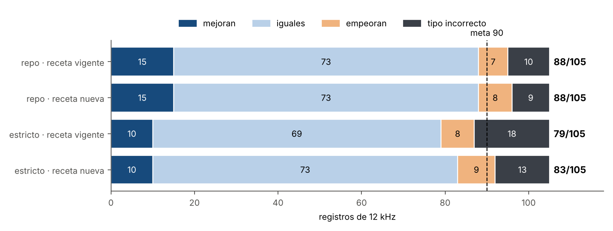

# 06 — Tipo de falla a ciegas con rasgos de peine

Mejora del clasificador de tipo de `05_Diagnostico_Ciego`. El método sigue siendo
ciego: recibe la señal, la frecuencia de muestreo y el catálogo completo del
rodamiento en Hz. No recibe el tipo real, la frecuencia esperada, las RPM, etiquetas
ni el nombre del archivo. La banda (`bandas_estables.py`), la regla de grado ND/PD/D
(`criterio_usuario.py`) y el detector sano/falla (`resultados_por_dominio/`) son los
del proyecto y no se tocaron.

## Qué cambia

El tipo se decide con la suma de dos discriminantes lineales regularizados:

1. **Árbol.** Los 1.953 rasgos existentes, pero en las nueve ventanas de 1 s que
   caben en toda la primera mitad de la señal, en lugar de las cuatro del prefijo
   de 2,5 s.
2. **Peine** (`peine.py`, 93 rasgos nuevos). En cada una de las 31 bandas se blanquea
   el espectro de la envolvente y, para cada familia del catálogo, se busca el
   deslizamiento entre −2 % y +2 % que mejor alinea hasta seis armónicas con
   tolerancia estrecha (±0,3 %). Una falla real desplaza todas sus armónicas en la
   misma proporción. El peine se mide además con las armónicas del eje anuladas,
   porque en el rodamiento del ventilador las frecuencias de falla casi coinciden
   con múltiplos del giro: BPFO ≈ 3,05·fr, 2·BSF ≈ 3,99·fr y BPFI ≈ 4,95·fr.
   Se agregan bandas laterales a ±fr y ±FTF y el peine del propio eje.

La segunda mitad de la señal no interviene en el tipo: sigue reservada para
verificar la banda.

## Resultados

105 registros de 12 kHz con referencia del paper. Sin retroceso = tipo correcto y
grado ≥ grado del paper. Detalle y cifras exactas en `resultados/resumen.md` y
`resultados/resumen.json`.

| Protocolo | Receta | Tipo correcto | Sin retroceso | IC 95 % |
| --- | --- | ---: | ---: | --- |
| Del proyecto: desarrollo fuera de grupo + modelo congelado | vigente | 95/105 | **88/105** | 76–91 % |
| | nueva | 96/105 | **88/105** | 75–92 % |
| Estricto: condición completa excluida en los 105 | vigente | 87/105 | **79/105** | 62–87 % |
| | nueva | 92/105 | **83/105** | 66–90 % |
| Estricto anidado: receta elegida dentro de cada pliegue | nueva | 92/105 | **83/105** | 66–90 % |

Señales sin referencia del paper: 21/24 tipos correctos a 48 kHz (una sin duración
suficiente) y 4/4 normales, igual que antes.



Lectura:

- **El protocolo del proyecto se reproduce exactamente** (88/105, con los mismos 105
  tipos y grados publicados). Con ese protocolo la receta nueva empata.
- **Con validación estricta el resultado vigente baja a 79/105.** En el protocolo del
  proyecto, 53 registros se evalúan con un modelo que ya vio otras cargas de su misma
  falla; ahí acierta 53/53. Al excluir siempre la condición completa, la misma receta
  acierta el tipo en 87/105.
- **La receta nueva sube a 83/105 en validación estricta** (tipo 92/105). La diferencia
  va en la dirección correcta pero no es estadísticamente concluyente: 8 registros
  pasan a acertar y 4 dejan de hacerlo (McNemar exacto, p = 0,39).
- **La meta de 90/105 no se alcanza.** Con el tipo perfecto y la regla de grado actual
  el techo es 95/105.

## Lo que no mejoró (y por qué importa)

- **La selección de banda está saturada.** En una exploración que no forma parte de
  este código se probaron cinco criterios de selección y el preblanqueo cepstral como
  candidato adicional; con el tipo correcto todos quedaron entre 95 y 96 de 105. El
  cuello de botella es el tipo, no la banda.
- **Cuatro errores no tienen arreglo con este protocolo.** Las fallas de 0,028″ se
  hicieron en rodamientos NTN, no SKF (documentación de CWRU). Al excluir IR 0,028″,
  las únicas señales de ese montaje que quedan son las de bola, y el modelo responde
  «bola». Eso es aprender la adquisición, no la falla.
- **Variantes descartadas** por no ser consistentes entre protocolos: fusión con los
  otros acelerómetros, entrenar también con las vistas de los otros sensores, añadir
  las señales de 48 kHz al entrenamiento, bosques aleatorios y regresión logística.
  Todas quedaron entre 76 y 86 en validación estricta, dentro del ruido.

## Advertencias

- No es validación externa. Se exploraron unas 35 variantes sobre estos mismos 105
  registros antes de fijar la receta. `--anidado` elige entre árbol, peine o ambos
  dentro de cada pliegue: eligió ambos en los 28 y da el mismo 83/105, pero no cubre
  el resto de la exploración.
- Los grados ND/PD/D siguen la regla propia del proyecto, no homologada con el paper.
- Sano frente a falla sigue apoyado en cuatro señales normales.

## Reproducir

Con los `.mat` en `data2/CWRU/` (ver README principal):

```shell
python 06_Tipo_Ciego_Peine/test_peine.py
python 06_Tipo_Ciego_Peine/test_evaluar.py
python 06_Tipo_Ciego_Peine/evaluar.py            # unos 12 minutos la primera vez
python 06_Tipo_Ciego_Peine/evaluar.py --anidado  # añade unos 40 minutos
```

El evaluador comprueba que las 133 señales tengan el mismo SHA-256 que
`comparacion_133.csv` y que la receta vigente reproduzca los tipos publicados antes
de informar nada. Los rasgos se guardan en `cache/` (no se sube a git).

Diagnóstico con los pesos congelados (`resultados/modelo_tipo.npz`, sin pickle):

```python
from predictor import predecir
resultado = predecir(x, fs, catalogo_completo)
```

| Archivo | Contenido |
| --- | --- |
| `peine.py` | Rasgos de peine con deslizamiento |
| `clasificador.py` | Ensamble de dos LDA, exportación e inferencia con NumPy |
| `evaluar.py` | Protocolos, métrica, intervalos, comparación pareada y modelo final |
| `predictor.py` | Diagnóstico completo con pesos congelados |
| `resultados/predicciones_105.csv` | Tipo, grado y estado por registro en cada protocolo |
| `resultados/otras_senales.csv` | 48 kHz con falla y normales |
